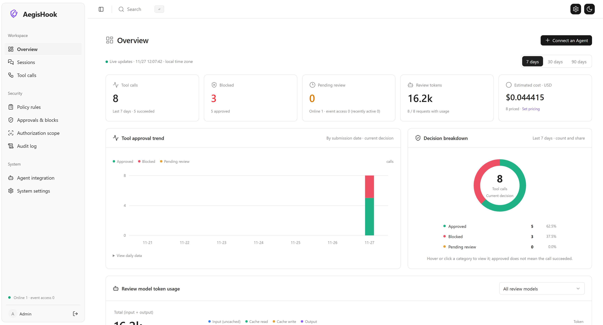
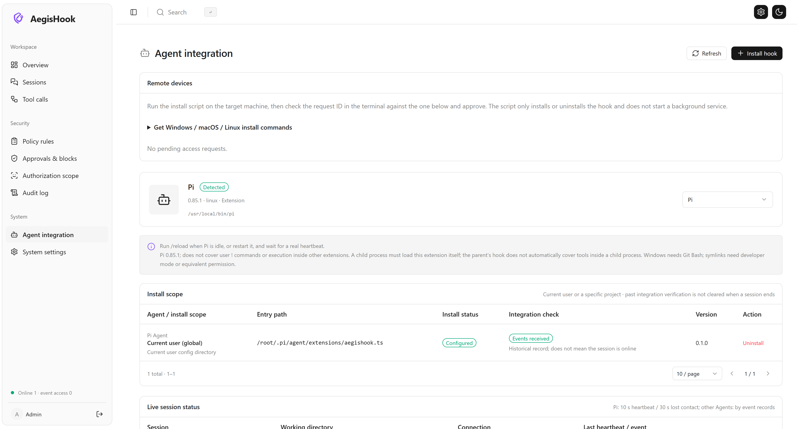
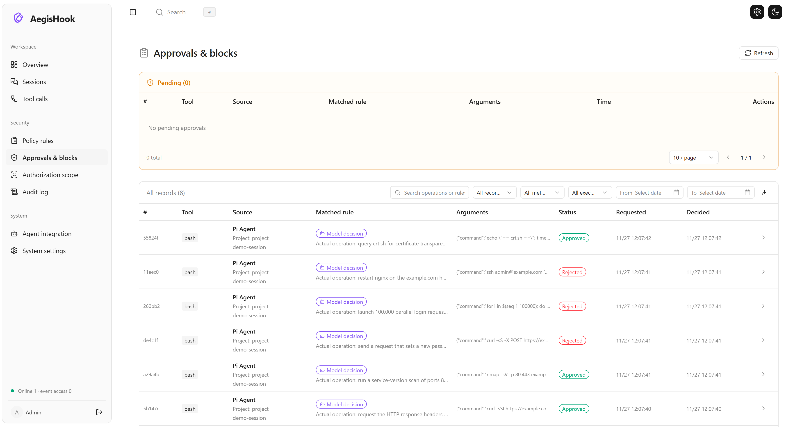
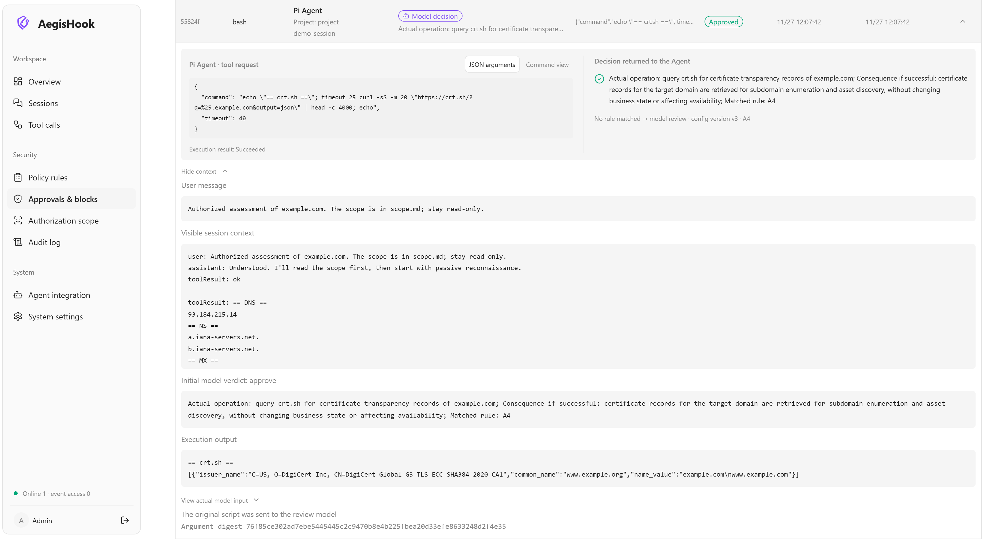

# AegisHook


[](https://github.com/montjeffrey/aegishook-en/actions/workflows/ci.yml)
[](LICENSE)

> English translation of [RuoJi6/AegisHook](https://github.com/RuoJi6/AegisHook). Console, CLI, hook messages, review prompts and docs are translated; behavior is unchanged.

A local Go + Vue 3 console that provides pre-execution tool call review, human approval, model decisions and auditing for Pi, Claude Code, Codex, OpenCode and Grok Build. The loopback address and port are configurable; use `-h` or `--help` for command help. It builds from source on macOS, Linux and Windows. The Go test suite runs on Windows in CI; real-client installation and trust flows on Windows still need to be verified on the target machine.









The screenshots use demo data against `example.com`; the calls were reviewed, not executed.


Remote Hook clients (a Hook on another machine reaching this service over an HTTPS reverse proxy) use `--public-url`, and are described in [Remote access](docs/remote-clients.md). Without `--public-url` the service is local only.

## Build from source

No release binaries are published for this repository yet, and the `Release` workflow has never produced one, so the download-and-run path described upstream does not apply here. Build from source; this is the supported way to run it. You need Go 1.27.4 or newer, Node 22.19+ and npm.

```sh
npm ci --prefix web
npm run build
```

This produces `bin/aegishook` (`binegishook.exe` on Windows). On Windows you can also run `powershell -File scripts/build.ps1`. The remote installer scripts (`scripts/hook.sh`, `scripts/hook.ps1`) download client binaries from `https://github.com/montjeffrey/aegishook-en/releases`; until a release exists they stop with an explicit "no release published" message. Until then, point them at your own build with `--binary` / `-Binary`, or serve builds with `--client-binaries` (see [Remote access](docs/remote-clients.md)).

This is an English translation of the upstream project. Upstream publishes its own releases at [RuoJi6/AegisHook](https://github.com/RuoJi6/AegisHook/releases); those are a different build and are not verified or supported here.

Regular pushes to `main` and pull requests run `CI` (Go on Linux and macOS, the Go suite on Windows, Pi/OpenCode tests and Linux browser tests).

## Getting started

For a local binary built from source:

```sh
./bin/aegishook serve --data-dir .data/local
```

Open <http://127.0.0.1:18790> and log in with the contents of the `admin.token` file named in the startup output. An admin session is valid for 12 hours. The default mode is human review. The data directory must stay private; do not place it in a web root or a shared directory.

When `--data-dir` is omitted, `~/.aegishook` is used. This development run uses `.data/local`; it holds the private token, the model key and SQLite, and is not part of the source delivery. After the service is shut down, a working AegisHook adapter explicitly rejects new tool calls, including read-only ones such as Read, grep and ls, because the allow rules are evaluated by the service. If the client does not load the Hook, does not start the command, or kills it by force on timeout, client behavior is covered in the integration boundaries below.

### Custom local address, port and help

The default listen address is `127.0.0.1:18790`. Use `--host` and `--port` separately, or keep using the full-address option `--addr`:

```sh
./bin/aegishook --host localhost --port 18800 --data-dir .data/local
./bin/aegishook serve --host ::1 --port 18800 --data-dir .data/local
./bin/aegishook serve --addr 127.0.0.1:18800 --data-dir .data/local

./bin/aegishook -h
./bin/aegishook --help
./bin/aegishook install -h
./bin/aegishook hook -h
```

When no command is given, `serve` runs by default. `--host` accepts only loopback addresses (`localhost`, `127.x.x.x`, `::1`), not `0.0.0.0` or LAN addresses; the port range is `1-65535`. For IPv6, write the full address as `--addr '[::1]:18800'`. `--addr` cannot be combined with `--host/--port`. The help command prints usage and exits normally, without creating data or starting the service.

| Option | Default | Description |
| --- | --- | --- |
| `--host` | `127.0.0.1` | Loopback address; for IPv6 use `::1` |
| `--port` | `18790` | Listen port, range `1-65535` |
| `--addr` | unset | Specify address and port at once, kept for compatibility; mutually exclusive with `--host/--port` |
| `--data-dir` | `~/.aegishook` | Private directory that stores the database, tokens and Hook connection config |
| `--agent-dir` | `PI_CODING_AGENT_DIR`, else `~/.pi/agent` | Pi user directory (`serve` and `install` only) |
| `--client-binaries` | unset | `serve` only. Directory of client binaries you host yourself for remote Hook installs; when omitted, remote installs download from the Release |
| `--trusted-proxies` | none | `serve` only. Comma-separated proxy CIDRs allowed to set `X-Real-IP`; no proxy is trusted by default |
| `--public-url` | unset | `serve` only. Public HTTPS origin of the reverse proxy in front of the service; local access only when omitted |
| `-h`, `--help` | - | Print command help and exit; `aegishook <command> -h` is also supported |

`serve`, `install`, `uninstall` and `status` all accept the address and port options above. Open the page at the address you actually configured, for example `http://localhost:18800` or `http://[::1]:18800`. If the port is in use, restart on a different port.

## Connect Pi

1. Open **Agent integration**, choose the current user (global) or a specific project, and create the Hook entry.
2. While Pi is idle, run `/reload`, or restart Pi.
3. Wait until the UI shows both an actual session connection and a recent heartbeat. Installed files do not mean Pi has loaded the extension.

You can also use commands:

```sh
./bin/aegishook install --data-dir .data/local --scope global
./bin/aegishook install --data-dir .data/local --scope project --project /absolute/project
./bin/aegishook status --data-dir .data/local
./bin/aegishook uninstall --data-dir .data/local --id INSTALLATION_ID
```

When a running service is detected, the commands operate through the admin API; multiple service processes may not open the same data directory at the same time. With a custom address or port, every command uses the same `--host/--port` or `--addr`, for example `./bin/aegishook status --data-dir .data/local --host localhost --port 18800`. After changing the listen address, reload or restart the connected Agents so they read the updated connection config.

- The global directory honors `PI_CODING_AGENT_DIR` and defaults to `~/.pi/agent`; it can be set explicitly with `--agent-dir`.
- The entry is `extensions/aegishook.ts`. Project entries live in the project's `.pi/extensions/`.
- All entries point to the same real adapter path inside the data directory, which lets Pi deduplicate them; installation is idempotent, and a same-named file not owned by AegisHook is never overwritten.
- Uninstalling removes only the selected entry. Sessions that are already loaded keep reviewing until they are reloaded or exit; the connection file and token are kept.
- Pi's project trust configuration is not changed. Extension disabling, load failures or trust restrictions in Pi must be handled in Pi.

## Connect other Agents

In **Agent integration**, pick an Agent, click **Install hook**, and choose global or a specific project. The UI shows the matching loading instructions. Pi stays the default selection; no global Hook is installed automatically for other clients.

| Agent | Integration | Current-user config | Project config | Activation |
| --- | --- | --- | --- | --- |
| Claude Code | Command Hook | `~/.claude/settings.json` | `.claude/settings.json` | Restart, check with `/hooks` |
| Codex CLI | Command Hook | `~/.codex/hooks.json` | `.codex/hooks.json` | Restart, review and trust the Hook in `/hooks`; the project must also be trusted |
| OpenCode 1.x | Plugin | `~/.config/opencode/plugins/aegishook.js` | `.opencode/plugins/aegishook.js` | Restart |
| Grok Build (`grok`) | Command Hook | `~/.grok/hooks/aegishook.json` | `.grok/hooks/aegishook.json` | Restart; confirm the project with `/hooks-trust` |

```sh
./bin/aegishook install --data-dir .data/local --agent claude --scope project --project /absolute/project
./bin/aegishook install --data-dir .data/local --agent codex --scope project --project /absolute/project
./bin/aegishook install --data-dir .data/local --agent opencode --scope project --project /absolute/project
./bin/aegishook install --data-dir .data/local --agent grok --scope project --project /absolute/project
```

- `CLAUDE_CONFIG_DIR`, `CODEX_HOME`, `OPENCODE_CONFIG_DIR` and `XDG_CONFIG_HOME` are honored. Project and program paths may contain spaces and non-ASCII characters. Keep the program path referenced by installed entries unchanged; uninstall the related entries before moving the program.
- JSON installation merges only its own event handlers and keeps other configuration; repeated installation is idempotent, and a modified own entry is reported as a conflict. Uninstalling does not change trust settings and keeps the connection config used by the original session. If a client caches entries, a restart is needed before they are fully removed.
- The original tool names and arguments are unchanged. An empty JSON response from Claude/Codex means this AegisHook review passed, and the client's own permission checks still apply; a rejection returns the reason through the client protocol and ends with exit code 2. OpenCode blocks the call by throwing an error in the before-tool callback.
- Claude and Codex global and project Hooks bind the same decision through a stable session / tool call ID; the two OpenCode entries import the same module and deduplicate by call ID and arguments. Grok's official documentation does not guarantee a call ID, so for now only one Grok installation scope is allowed per data directory, to avoid duplicate reviews when there is no ID. When Grok also discovers the Claude config, the Claude adapter skips itself through the official Grok event environment variable and the dedicated Grok entry does the review.
- Command Hooks and the OpenCode plugin register a session per event and keep a heartbeat only while waiting for a review. The UI counts continuously online sessions and event access separately; an event session that received an event or a review heartbeat within 30 seconds shows "recently active" and a colored status dot, and when idle shows "no recent events"; neither is used to infer that the process has exited. Each installation scope shows its installation status (Configured / Entry error / Uninstalled) and its historical integration verification (Events received / No events yet) separately; a session ending or a service restart does not clear the historical integration evidence of the associated installation. A session ending invalidates pending approval calls; if a process is killed without an end event, waiting calls are rejected after the heartbeat expires.
- The Codex CLI and the runtime bundled in the desktop app may be different versions; the version the page detects comes from the CLI on `PATH`, so it cannot be used to assert the desktop version or Hook coverage. Upgrading the CLI does not update the desktop app; restart both separately and check the actual events. "Events received" for the same installation scope does not mean both ends have been verified. Project trust and Hook definition trust are two separate checks, and installed files alone do not count as integration verification.
- Reviewing a subagent's tool calls and showing parent-child relationships are different capabilities. `SubagentStart` / `SubagentStop` are not subscribed to, and no subagent identity field is stored. Claude subagent tool events carry `agent_id`, and Codex subagent Hooks use the parent session ID, so calls may appear inside the parent session; Grok and OpenCode child sessions can be stored separately under their own session IDs, but the parent-child link is not shown yet. Pi child processes must load the extension on their own. Verify coverage from child-session / call evidence; do not infer a missed review from the subagent count in the UI, and do not promise full coverage from the partial calls observed. See [Claude Hook input](https://code.claude.com/docs/en/hooks#common-input-fields), [Codex Hook coverage](https://developers.openai.com/codex/hooks#tool-coverage), [Grok Hooks](https://docs.x.ai/build/features/hooks) and [OpenCode plugins](https://dev.opencode.ai/docs/plugins/).
- A post-execution event must be linkable to the original call and carry a reliable status before success or failure is recorded. When Grok has no call ID or Codex has no explicit result status, "Awaiting execution result" is kept and success is not inferred. If the client's own permission check rejects the call again, execution success is not recorded just because AegisHook approved it.
- Case variants of names such as `Read/Write/Edit` are supported, along with the common argument fields `path/file_path/filePath` and `command/cmd`. Explicit Windows account, service, firewall and scheduled task commands are now recognized; complex PowerShell and dynamic scripts are still left to the selected review mode, which does not mean static analysis proved them safe.

Integration references: [Claude Hook docs](https://code.claude.com/docs/en/hooks), [Codex Hook docs](https://learn.chatgpt.com/docs/hooks), [OpenCode plugin docs](https://opencode.ai/docs/plugins/), [OpenCode 1.17.9 plugin discovery code](https://github.com/anomalyco/opencode/blob/v1.17.9/packages/opencode/src/config/plugin.ts), [Grok Build Hook docs](https://docs.x.ai/build/features/hooks). The Grok Code model itself has no standalone Hook; what is integrated is the Grok Build CLI that hosts the model.

### Windows

Run the Windows build of the service and the Agent on a Windows machine; with WSL, run the Linux build of the service and the Agent in the same WSL environment. Remote Hook clients are possible only through an HTTPS reverse proxy configured with `--public-url` (see [Remote access](docs/remote-clients.md)); the service itself still listens on loopback only.

```powershell
.\bin\aegishook.exe serve --data-dir "$env:LOCALAPPDATA\AegisHook"
.\bin\aegishook.exe install --data-dir "$env:LOCALAPPDATA\AegisHook" --agent claude --scope project --project "C:\work\project"

# Custom local address and port
.\bin\aegishook.exe serve --host localhost --port 18800 --data-dir "$env:LOCALAPPDATA\AegisHook"
.\bin\aegishook.exe status --host localhost --port 18800 --data-dir "$env:LOCALAPPDATA\AegisHook"
.\bin\aegishook.exe -h
```

The service uses Windows file locks; command Hooks use PowerShell and preserve the original process exit code. Pi symlink installation also needs Windows Developer Mode or the permission to create symbolic links, and Pi's Bash tool needs Git Bash. Access to a private directory on Windows is decided by the local ACL, so place it in the current user's private directory; POSIX 0600 permissions are not equivalent to Windows ACL isolation. No real Windows machine was available this time, so installation, shell selection and client trust flows still need to be verified on the target machine.

## Review modes

Execution order: Authorization scope -> enabled reject rules -> allow rules -> human or model review -> persist decision and audit -> return to the Agent -> record the actual execution result.

The built-in R1-R6 reject by default explicit password/login changes, target system configuration changes, account permission changes, destruction of critical data, stopping business services, and DoS. System account creation commands are also rejected by default; for a normal business registration request that reaches model review, creating a separate ordinary or guest account dedicated to this test and saving its login cookie is allowed, but overwriting an existing user, impersonating someone else or granting high privileges is not. R1-R6 and A7 can all be edited in **Policy rules**: name, enabled state, decision, match conditions, priority and the returned message. The built-in ID marks where a rule came from; it is not a restriction that cannot be changed. Built-in rules can be disabled, **Restore default** in the edit window fills in the preset, and changes take effect once saved. Built-in rules keep their entries so they can be restored; custom rules can be deleted.

Reject takes priority over allow; within the same kind, rules match by priority in descending order, then by ID in ascending order. Only a currently enabled reject rule that matches blocks the call, and its decision cannot be overridden by a human or a model. By default A7 allows read, grep, find and ls. Built-in semantic matching can narrow the tool scope, or be replaced by regex / contains-text matching (on the tool name or an argument path). All changes are persisted and bump the config version, and calls that were already submitted keep their original rule snapshot. Old rules remain compatible automatically, and a restart does not overwrite modified values. After a rule is disabled, calls it no longer decides go to the current review mode; the AI prompt is still configured separately.

Rule configuration follows the [ARTEX rule data structure](https://github.com/Autumn-27/ARTEX/blob/f270ca66bcd845447aed71842f743282dfc0fc91/db/intercept.go) and its [matching implementation](https://github.com/Autumn-27/ARTEX/blob/f270ca66bcd845447aed71842f743282dfc0fc91/intercept/intercept.go): editable conditions, string / regex matching, priority and message. AegisHook keeps reject-first precedence and the reject-on-error behavior, and does not adopt ARTEX's global first-match or allow-on-model-failure behavior.

The built-in catalog provides 26 rules covering baseline constraints, system commands, databases and HTTP requests; the data-exfiltration pipe rule is disabled by default. The rules page can search names and commands, filter by enabled state, use sliding switches, and expand each rule to see its full detection conditions, samples and recognition scope. For specific coverage and how older versions upgrade, see the [rule catalog](docs/rules.md).

In human mode, a call not decided by rules waits for **Allow this call** or a rejection with a reason; the default timeout is 600 seconds. An approval is bound to the call ID, the tool name and the SHA-256 of the original arguments. A resubmission with changed arguments is rejected, and clicking repeatedly does not produce a second permit. A service restart, a session ending or a heartbeat that stops (lost contact) invalidates pending approval requests.

Model mode uses a separate model configuration, with a default timeout of 20 seconds. The default prompt follows ARTEX's judgment of asset ownership and recoverability: R1-R6 reject operations that clearly harm real business assets, A1-A7 allow non-destructive probing and verification, the model decides directly even when information is insufficient, and D1 approves by default when no operation that clearly harms real business assets is found. Rule IDs keep their AegisHook meaning and do not use ARTEX's output format directly.

**Limit bulk data retrieval after a vulnerability is confirmed** is off by default. The switch inserts or removes the R7 rule block, delimited by start and end markers, in the current prompt, and takes effect once saved; restoring the default turns it off. On upgrade, only an old R7 block identical to the v0.1.1 default is replaced automatically, with the config version and an audit entry saved; other custom content and a disabled state are kept. The new R7 template limits evidence collection through a confirmed vulnerability based only on the current arguments: for the same target and the same vulnerability, one call may retrieve at most 10 business records and at most 5 sensitive files, with at most 500 MB of necessary fragments read per file; when a call contains a loop or several requests, the amounts read in that call are added together. A clearly bounded retrieval within this call's quota does not match R7, and using a loop or the fact that the vulnerability is established is not a reason to reject; clearly unbounded or over-quota retrieval is rejected; normal downloads of frontend resources such as web pages, JS and CSS, and status checks, do not count toward the quota. The model receives no history, so it cannot tell the historical verification state or the cumulative amount across calls; a cumulative quota in an old prompt cannot be inferred out of thin air either. The quota is enforced by prompt guidance to the model, and there is no backend counter yet. This limit applies only to calls that reach model review; an earlier allow rule may still approve a call directly.

Model review sends only the current `toolName`, `argumentsObj` and `hitlMode`, and does not send historical commands, historical execution results, the user session or historical approval conclusions. The server constrains all Agents and the OpenAI / Anthropic interfaces through one shared allowlist, so the `userMessage` / `context` reported by old clients never reaches the model either. Pi no longer collects the last 6 tool execution records and keeps only the most recent user message for local auditing and human viewing; this takes effect after the extension is reloaded, and the server-side limit on the current call does not wait for client upgrades. Saved background and historical decisions are not rewritten, and new model review records have an empty-string `modelContext`. Existing custom prompts are kept, and the server appends a boundary to the actual request that limits the review to the current call only.

When a model decision has a JSON syntax or structure error (for example a code fence, an extra field or a wrong field type), the format problem is fed back to the model and retried up to 3 times (at most 4 requests including the first), and all attempts share the configured model timeout budget. Connection failures, HTTP errors, response protocol errors, incomplete output, and an invalid decision value or rule are not retried; if retries are exhausted the call is still rejected. Usage from retries is merged into this review; if any attempt lacks usage, the total usage and cost are marked unknown.

The model returns only a JSON `decision` (approve/reject) and a `comment` (actual operation, consequence if successful, rule ID); handing off to a human is not supported. For an unknown script or insufficient information, the model decides from the visible content and D1, and this does not assert safety. A model call cannot be overturned through the human approval API; historical records where the model handed off to a human keep their original decision for auditing.

Transport errors, timeouts, response format errors, rule ID errors and model suggestions to modify arguments are all rejected, and `ask` is also treated as an invalid decision. Context and arguments are data to be reviewed and must not rewrite the review rules; they are redacted first, then sent to the model and stored, and no nonexistent reasoning process is generated. Earlier rules still run first, and the model prompt handles only the calls they did not decide. Changes to the default template do not automatically overwrite custom prompts in other installed instances; you can restore the default in the settings and save.

### OpenAI and Anthropic

In **System settings**, choose the protocol, fill in the Base URL, model and a separate API Key, save, and click **Test saved configuration**. Model review mode can be saved only after the test succeeds. Changing the protocol, address, model or key clears the test state; if the system is already in model mode, switch back to human mode before saving these changes.

| Protocol | DashScope Base URL | Backend call path |
| --- | --- | --- |
| OpenAI compatible | `https://dashscope.aliyuncs.com/compatible-mode/v1` | `/chat/completions` |
| Anthropic Messages | `https://dashscope.aliyuncs.com/apps/anthropic` | `/v1/messages` |

Both protocols have been tested with `qwen-flash`. OpenAI uses Bearer authentication; Anthropic uses `x-api-key` and `anthropic-version: 2023-06-01`. Only non-streaming requests are sent, and Pi credentials are not read. Remote addresses require HTTPS, loopback test servers may use HTTP; redirects are not followed.

The key is stored in `model.key` (permission 0600) in the private data directory; the settings API returns only whether a key is saved, never the key. To clear the key, send `apiKey: ""` in the settings request of the admin API. The raw plaintext input and the context may themselves contain secrets; the built-in redaction covers sensitive object fields, common command arguments, Bearer values, JSON strings and URL credentials, and cannot guarantee that secrets in arbitrary unlabeled text are recognized.

References: [Alibaba Cloud OpenAI compatibility docs](https://help.aliyun.com/zh/model-studio/compatibility-of-openai-with-dashscope), [Anthropic Messages compatibility docs](https://help.aliyun.com/zh/model-studio/anthropic-api-messages).

## Pages and data

The project mark is a purple fusion of a shield and a hook, with an SVG that has a transparent background. The login page, loading page, sidebar and browser tab all use [logo.svg](web/public/logo.svg), and the pages reuse the icon through [BrandLogo.vue](web/src/components/BrandLogo.vue), adapted to a collapsed sidebar and narrow screens. After updating the program, restart the service and refresh the page to load the new icon.

- Overview, Sessions: actual connections, call statistics, and review and execution timelines.
- Tool calls, Approvals & blocks: pending approvals, filters, arguments and context, decision reasons, execution results, JSON export.
- Policy rules: management of built-in and custom rules; tool name, argument path and regex matching; sample dry runs that do not execute tools. Arguments such as `command`, `path`, `url`, `host`, `target`, `operation` and `method` can be used as match fields.
- Authorization scope: associated projects, exact target hosts, file path ranges. All applicable scopes must be satisfied; an empty list means no extra restriction on that dimension.
- Agent integration: detection, global/project installation, uninstallation, loading and connection diagnostics.
- System settings, Audit log: mode, the two API protocols, prompt restore and versions, config change tracking.

Decisions and execution results are stored separately. "Approved" only means a permit; the execution result can be awaiting result, succeeded, failed or not executed. With no result reported back, the awaiting state is kept. Rejected calls are stored during the review stage and do not depend on Pi's `tool_result` event.

Changes to configuration, rules and scopes affect only new requests. Each review keeps a snapshot of the mode, config version, prompt, rules and scopes at submission time. Non-secret settings versions are stored in SQLite and can be queried through the admin API `/api/v1/settings/versions`. SSE pushes updates; the Pi heartbeat is 10 seconds, and the lost-contact threshold for a connection during a review is 30 seconds. Idle event records from other Agents do not mean continuously online.

All endpoints live under `/api/v1`. The admin side uses an HttpOnly, SameSite=Strict session cookie and validates Host/Origin. The Hook Bearer token may be used only for session register/heartbeat/deregister and the review/result endpoints; it cannot change policy or uninstall a Hook. A SQLite transaction commits the decision and the audit entry together; if the audit write fails, no permit is returned.

## Boundaries

If a command Hook cannot start, is disabled, is untrusted, a plugin fails to load, or it is killed by the client on timeout, tool blocking cannot be guaranteed. In particular, Grok's official documentation states that these failures default to allow; once the adapter has started successfully, a service that is offline, an invalid decision or an audit failure is explicitly rejected (an offline service blocks read-only tools too). Installed files do not mean you are already protected. Codex-managed tools and later `write_stdin` calls do not necessarily trigger a before-tool event; AegisHook cannot widen the review scope the client provides.

This is **Agent tool-call-level review**, not operating system permission isolation or an execution sandbox. The shell AST only helps recognize explicit operations; complex, dynamic or opaque scripts go to the current review mode, and that does not prove the script is safe.

It does not cover the user's `!` commands, `pi.exec()` calls inside other extensions, every side effect inside a script, or operations on clients that are not connected. Other extensions may change tool arguments along the event chain; load only trusted extensions. The same user can uninstall or modify extensions, tokens and local configuration, so this tool is not an unbypassable security boundary.

### Self-protection is defence in depth, not a boundary

Before any rule or reviewer runs, a fixed check refuses calls that name the gate's own data directory, credentials, installed hook files or the agent hook configuration (including `~`, environment-variable, quoted/escaped, glob and case variants). A command (the Bash tool, or any tool with a `command` or `cmd` argument) whose masked "secret" contains shell syntax is refused outright; in file writes and other tools such text is data. A call with any hidden redacted span is never approved by a model or a rule, a human must confirm it. This is a static, best-effort check on the text of the call. It cannot see a path a shell builds at run time (for example `d=.aegis; cat ~/${d}hook/admin.token`), a whole-home recursive read such as `grep -r token ~`, or a Windows junction. Some ordinary calls are refused or sent to a human as a side effect (for example editing a README that mentions `~/.aegishook`, or `git add .claude/settings.json` in a project); `internal/core/false_positive_test.go` pins what happens today.

An agent that runs as the same operating-system user as the gate can always read that user's files, including `admin.token` and `model.key`; no check inside the gate can prevent that. The strong options are to run the gate under a separate OS user (with a private data directory the agent's user cannot read) and to avoid keeping the admin token in clear text on disk. Treat the built-in check as a guard against mistakes and simple bypasses, not against a determined agent.

The service itself has no built-in remote node mode (remote Hook clients go through an HTTPS reverse proxy, see above), and the first version does not provide web chat, automatic retry of execution, or an execution sandbox. Lists and filters are meant for small-scale local auditing, and server-side pagination and archiving for large amounts of history are not yet available. Linux and Windows have been verified by cross-compilation. Pi is verified with the real loader and the Agent loop; the added clients are verified with official protocol fixtures and the actual OpenCode adapter callbacks, and a full model-driven end-to-end session acceptance for each of the four clients has not been completed.

## Development and verification

Requires Go 1.27.4+, Node 22.19+ and npm.

```sh
npm run build
npm --prefix adapter ci
npm run adapter:check
npm run test:go
npm run test:adapter
node --test adapter/opencode.test.mjs
npm --prefix web exec -- playwright install chromium
npm run test:e2e
```

`npm run build` builds Vue and embeds the pages and the adapter into the Go program, producing `bin/aegishook`. The pure-Go SQLite driver does not depend on a local C compiler. You can build the Linux version with `GOOS=linux GOARCH=amd64 CGO_ENABLED=0 go build -o bin/aegishook-linux-amd64 ./cmd/aegishook`; set `GOOS=windows GOARCH=amd64` and name the output `.exe` to build the Windows version. For a full native Windows build, run `powershell -File scripts/build.ps1`.

Adapter tests use the real extension loader and Agent loop of Pi 0.85.1, but the tools and models are isolated stand-ins, and they never delete a real account or change a password. Browser tests run in a temporary data directory and use 18794/18795/18797; Pi adapter tests use 18792, and OpenCode callback tests use 18798. Test data never enters the normal console.

Command-line tests cover the default address, a custom port, `localhost`, IPv4/IPv6 loopback addresses, the original `--addr`, option conflicts, invalid addresses/ports and help output. The Go service and the command Hook share the same loopback address validation, and the Pi adapter verifies the same range separately, ensuring a custom address can still connect and be reviewed.

An existing Chromium can be specified with `AEGIS_CHROMIUM=/absolute/path/to/chromium npm run test:e2e`. In a restricted sandbox, the tests need loopback ports and permission to launch the browser.

The real cloud model test is opt-in: put the key in a private file and run `AEGIS_LIVE_KEY_FILE=/private/path/key go test -run TestLiveDashScope -v ./internal/core`. It sends only a synthetic README-read review, and sends no real sessions, file contents or execution instructions.

For acceptance notes, see [docs/qa/README.md](docs/qa/README.md). Development screenshots and design references are kept locally and are not part of the source.

## License

[MIT](LICENSE). Third-party dependencies remain under their own licenses.

## Overview dashboard and review cost

Overview first shows the tool approval trend and the decision donut chart for the last 7 / 30 / 90 days, then the review token and estimated cost trends. Hover or tap to see daily values; the trend chart supports the left/right arrow keys and Home / End, and the donut chart lets you select a category to see its count and share. The model filter applies only to usage and cost, while the tool review trend covers all tool calls; dates are bucketed in the browser's local time zone, and the filter is kept in the URL. The charts come with a daily data table and support both themes and narrow screens.

Only AegisHook review model requests are counted (including connection tests), not the Agent's own model usage. OpenAI's input cache is a subset of `prompt_tokens`; Anthropic input, cache reads and cache writes are recorded separately and are not double-counted in totals. A missing `usage` or an unparseable response is recorded as unknown; usage that older versions did not collect is not backfilled. Valid usage returned with an invalid decision is still counted.

In System settings you can enable cost estimation and enter the per-million-token prices (CNY / USD) for the current model's input, output, cache reads and cache writes. Each request stores a price snapshot from the configuration at that time; when switching model or provider, check the prices as well. 0 means free, and not enabled means unpriced. Costs exclude taxes, plans, tiers and currency conversion, cache writes are estimated at a single unified price, and the provider's bill is final. Dates with unknown costs are left blank in the trend, and the priced subtotal is shown separately.

Usage sources: [OpenAI Chat Completions](https://developers.openai.com/api/reference/resources/chat), [Anthropic prompt caching metering](https://platform.claude.com/docs/zh-CN/build-with-claude/prompt-caching).

References: [https://github.com/Ed1s0nZ/CyberStrikeAI](https://github.com/Ed1s0nZ/CyberStrikeAI) [https://github.com/Autumn-27/ARTEX](https://github.com/Autumn-27/ARTEX)
